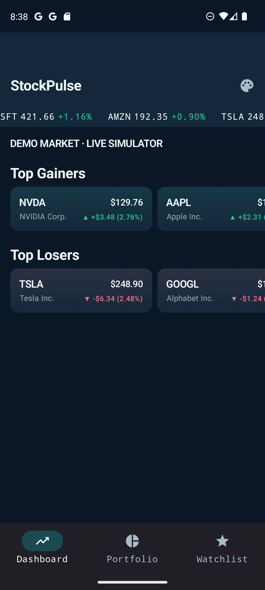
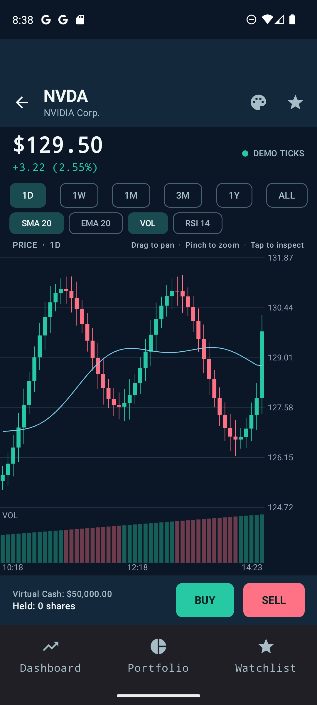
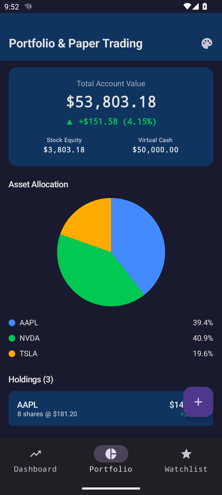
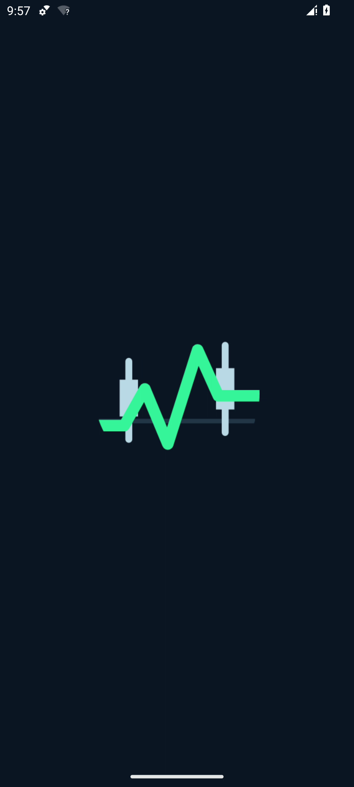

# StockPulse

Android stock tracking and portfolio demo built with Jetpack Compose. It ships with deterministic market data and runs without an API key or network connection. All prices, candles, and simulated ticks are examples, not live market data.

| Dashboard | Stock detail | Portfolio | Splash |
|:--:|:--:|:--:|:--:|
|  |  |  |  |

## Architecture

Multi-module Clean Architecture with MVI pattern.

```
├── app/                    → Application entry point, navigation host, Hilt setup
├── core/
│   ├── network/            → Demo tick stream; optional WebSocket and Retrofit code
│   ├── database/           → Room DB (tickers, candles, watchlists)
│   ├── designsystem/       → Material 3 theme, trading-specific colors, canvas components
│   └── model/              → Domain models (CandleData, StockQuote, OrderBook)
└── feature/
    ├── dashboard/          → Market overview and ticker marquee
    ├── stock-detail/       → Candlestick chart with simulated price ticks
    ├── portfolio/          → P&L tracker, asset allocation charts
    └── sync/               → Periodic refresh from bundled demo data
```

## Tech Stack

| Layer | Tech |
|-------|------|
| UI | Jetpack Compose, Material 3, Canvas API |
| Architecture | MVI + Clean Architecture |
| DI | Dagger Hilt |
| Async | Coroutines, StateFlow, SharedFlow |
| Network | OkHttp WebSocket, Retrofit |
| Persistence | Room |
| Background | WorkManager |
| Testing | Turbine, MockK, Coroutines Test |

## Building

Open the project in Android Studio, sync Gradle, and run on API 26+. The command line build is `./gradlew :app:assembleDebug` (or `gradlew.bat :app:assembleDebug` on Windows).

## Demo data

Eight sample symbols and their chart series are defined in `core/model/DemoMarketData.kt`. A new database starts with three sample portfolio holdings and two watchlist entries. Room persists subsequent watchlist and portfolio changes. The detail screen emits local simulated price ticks every 1.5 seconds. WorkManager refreshes cached quotes from the same bundled data without a network constraint.

The stock detail screen includes a paper-trade sheet using a local cash balance and holdings. Trades stay on the device and use demo prices.

The unused Finnhub API and WebSocket implementation remain in `core/network` as a starting point for a future live-data integration. `NetworkConstants.DEMO_MODE` keeps the demo tick stream active. No real trades, quotes, or order book updates are claimed.

## Implementation notes

- The WebSocket client retains Finnhub parsing and exponential reconnect logic for a future live-data mode; the shipped app uses a local tick generator.
- The stock detail ViewModel applies MVI intents and conflates only the tick stream. Connection events remain separate.
- The Canvas chart renders OHLC candles with SMA and EMA overlays and supports zooming and panning.
- The chart gives price, volume, RSI, and time labels separate regions. Tap a candle to inspect OHLC values, drag to pan, pinch to zoom, and double-tap to reset. See the [inspection screenshot](docs/screenshots/chart-inspect.png).
- Room stores demo quotes, candles, watchlist entries, and portfolio holdings. The portfolio screen reads and writes Room data.

Dashboard search and order book data are not implemented yet.

## Verification

`gradlew.bat :app:assembleDebug :feature:stock-detail:testDebugUnitTest` passes. On an API 34 emulator, the dashboard, chart, watchlist, portfolio, paper-trade sheet, launcher logo, and splash screen were checked. The app also launched and displayed quotes and candles with Wi-Fi and mobile data disabled. Emulator captures are in `docs/screenshots/`.
